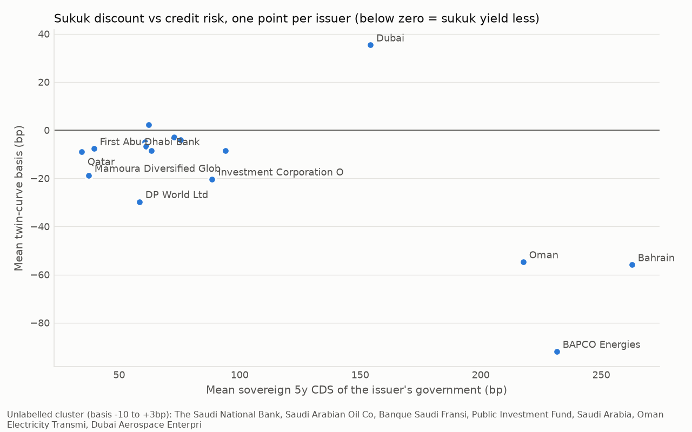

# Credit stress and the sukuk discount

Generated 2026-10-25. Issuer-month panel from the twin-curve basis.

## Data

- **Basis:** twin-curve basis (sukuk yield minus same-maturity conventional yield, bp), issuer-month mean.
- **Credit measure:** sovereign 5y USD CDS (`MID_SPREAD`) of the issuer's government. CDS comes from outside the bond data, so noise in the conventional yield cannot feed both sides of the regression (the problem with using the issuer's own conventional spread, kept below only for comparison). Government-related issuers are mapped to their owner (e.g. Aramco, PIF, SNB to KSA; BAPCO to Bahrain; ICD, DP World, DAE to Dubai; FAB, Mamoura to Abu Dhabi).
- **CDS codes and start dates:** KSA `SAGV5YUSAC=R` from 2016-01; Bahrain `BHGV5YUSAC=R` from 2016-01; Qatar `QAGV5YUSAC=R` from 2016-01; Abu Dhabi `ABUU5YUSAC=R` from 2016-01; Dubai `DUBA5YUSAC=R` from 2016-01; Oman `OMGV5YUSAC=MG` from 2017-08. No Sharjah or UAE-federal CDS is available, so Sharjah and Arab Energy Fund drop out of the CDS regressions.
- **Liquidity gap:** sukuk minus conventional median bid-ask spread (bp of yield) for the issuer-month. It controls for the alternative explanation that sukuk simply trade less.
- **Inference:** issuer fixed effects; t-stats clustered by issuer and Driscoll-Kraay (robust to common monthly shocks). With about 16 issuers, read t-stats near 2 with care.

## Across issuers: is the discount bigger for weaker credits?

| model | issuers | corr | spearman | slope_per_100bp | t_robust | slope_with_liq_control | t_with_liq | liq_gap_coef | liq_gap_t |
|---|---|---|---|---|---|---|---|---|---|
| Conventional spread, all issuers | 18 | -0.74 | -0.53 | -25.6 | -4.43 | -26.4 | -4.29 | -0.69 | -0.69 |
| Sovereign CDS | 16 | -0.65 | -0.25 | -25.6 | -2.92 | -25.7 | -2.75 | -0.69 | -0.44 |
| Sovereign CDS, excluding Dubai govt | 15 | -0.86 | -0.36 | -30.4 | -4.44 | -30.7 | -5.39 | 0.85 | 0.99 |

## Within issuers over time: does the discount widen when credit risk rises?

Slope = change in basis (bp) per 100bp rise in the credit measure.

| model | n_obs | issuers | slope_per_100bp | t_cluster_issuer | t_driscoll_kraay | liq_gap_coef | liq_gap_t |
|---|---|---|---|---|---|---|---|
| Conventional spread (mechanically biased, for comparison) | 957 | 18 | -19.2 | -4.38 | -7.46 |  |  |
| Sovereign CDS | 850 | 16 | -21.3 | -5.74 | -5.9 |  |  |
| Sovereign CDS + liquidity gap | 850 | 16 | -22.0 | -5.41 | -6.15 | -0.81 | -4.12 |
| CDS lagged 1 month + liquidity gap | 834 | 16 | -18.7 | -4.15 | -4.58 | -0.75 | -3.61 |
| CDS + liquidity + month FE | 850 | 16 | -30.3 | -6.75 | -6.7 | -0.66 | -2.29 |
| Sovereign issuers only (own CDS) | 381 | 5 | -19.8 | -11.55 | -5.89 | -0.58 | -1.15 |
| Excluding Dubai govt (20y brackets) | 796 | 15 | -23.1 | -5.36 | -6.02 | -0.93 | -5.83 |
| Excluding 2020 | 805 | 16 | -22.7 | -2.06 | -3.32 | -0.83 | -3.3 |

## Robustness: leave one government out

Issuers that share a government share its CDS series, so there are only six independent credit series. Each row drops one government's issuers. *t (cluster government)* clusters standard errors by government (very few clusters, so conservative and approximate).

| dropped | issuers | within_slope_per_100bp | t_cluster_issuer | t_cluster_government | cross_slope_per_100bp | cross_t | cross_spearman |
|---|---|---|---|---|---|---|---|
| none | 16 | -22.0 | -5.41 | -4.81 | -25.6 | -2.92 | -0.24 |
| Abu Dhabi | 14 | -22.0 | -5.37 | -4.69 | -27.8 | -3.13 | -0.33 |
| Bahrain | 14 | -17.5 | -4.37 | -3.45 | -8.3 | -0.41 | 0.13 |
| Dubai | 12 | -24.5 | -5.26 | -5.88 | -31.5 | -4.51 | -0.28 |
| KSA | 11 | -22.6 | -5.32 | -4.83 | -24.0 | -2.78 | -0.46 |
| Oman | 14 | -23.1 | -2.03 | -1.85 | -24.1 | -2.06 | -0.12 |
| Qatar | 15 | -22.0 | -5.4 | -4.71 | -26.3 | -2.95 | -0.31 |

## Reading the results

- **Within issuers (main result):** the slope is stable whichever government is dropped. Its precision leans on Oman, whose CDS ranged most widely.
- **Across issuers:** the cross-sectional slope depends on Bahrain (sovereign and BAPCO). Without it there is no gradient among issuers with CDS below about 100bp. Describe the cross-section as a threshold (large discounts for the sub-investment-grade sovereigns, small elsewhere), not a smooth gradient.
- **Liquidity:** the liquidity-gap coefficient is *negative*: months when sukuk are relatively less liquid are months when they yield relatively *less*. A liquidity premium would show the opposite sign, so liquidity does not explain the discount.

## Issuer means

| parent_name | cds_sovereign | months | basis | cds | spread_conv | ba_sukuk | ba_conv | liq_gap |
|---|---|---|---|---|---|---|---|---|
| Qatar, State of (Government) | Qatar | 12 | -9.0 | 34.4 | 31.3 | 3.0 | 3.8 | -0.8 |
| Mamoura Diversified Global Holding PJSC | Abu Dhabi | 31 | -18.8 | 37.3 | 76.8 | 4.8 | 3.9 | 0.9 |
| First Abu Dhabi Bank PJSC | Abu Dhabi | 49 | -7.7 | 39.5 | 75.3 | 10.9 | 4.8 | 6.1 |
| DP World Ltd | Dubai | 22 | -29.7 | 58.4 | 138.7 | 8.1 | 7.6 | 0.5 |
| The Saudi National Bank SJSC | KSA | 49 | -4.9 | 60.7 | 88.3 | 7.3 | 7.8 | -0.5 |
| Saudi Arabian Oil Co | KSA | 65 | -6.8 | 61.2 | 87.4 | 8.0 | 5.2 | 2.8 |
| Banque Saudi Fransi SJSC | KSA | 42 | 2.2 | 62.3 | 91.0 | 7.1 | 6.4 | 0.7 |
| Public Investment Fund | KSA | 37 | -8.6 | 63.3 | 95.2 | 5.6 | 4.3 | 1.4 |
| Saudi Arabia, Kingdom of (Government) | KSA | 115 | -2.8 | 72.7 | 97.1 | 4.9 | 5.0 | -0.1 |
| Oman Electricity Transmission Company S.A.O.C | Oman | 13 | -4.1 | 75.6 | 108.8 | 14.3 | 23.7 | -9.3 |
| Investment Corporation Of Dubai | Dubai | 55 | -20.3 | 88.6 | 154.9 | 20.0 | 27.6 | -7.6 |
| Dubai Aerospace Enterprise (DAE) Ltd | Dubai | 39 | -8.6 | 94.2 | 174.3 | 23.7 | 16.3 | 7.4 |
| Dubai, Emirate of | Dubai | 75 | 35.4 | 154.2 | 174.5 | 6.4 | 15.0 | -8.6 |
| Oman, Sultanate of (Government) | Oman | 97 | -54.7 | 217.6 | 252.1 | 17.8 | 13.0 | 4.8 |
| BAPCO Energies BSCC Closed | Bahrain | 67 | -91.9 | 231.5 | 311.0 | 16.3 | 23.8 | -7.5 |
| Bahrain, Kingdom of (Government) | Bahrain | 110 | -55.9 | 262.7 | 294.8 | 18.9 | 12.9 | 6.0 |
| Arab Energy Fund |  | 12 | -1.5 |  | 51.2 | 26.3 | 11.7 | 14.6 |
| Sharjah, Emirate Of |  | 67 | -43.6 |  | 199.5 | 9.6 | 5.1 | 4.5 |

## Caveats

- CDS for government-related issuers is the *owner's* credit, a proxy for state support rather than the issuer's own risk.
- Few issuers (about 16 with CDS), and before 2021 only 4. Month fixed effects identify the slope only from differences between six CDS series.
- Bid-ask spreads are LSEG composite quotes, a rough liquidity measure.
- Dubai's basis relies on wide interpolation brackets. See the excluding-Dubai rows.
