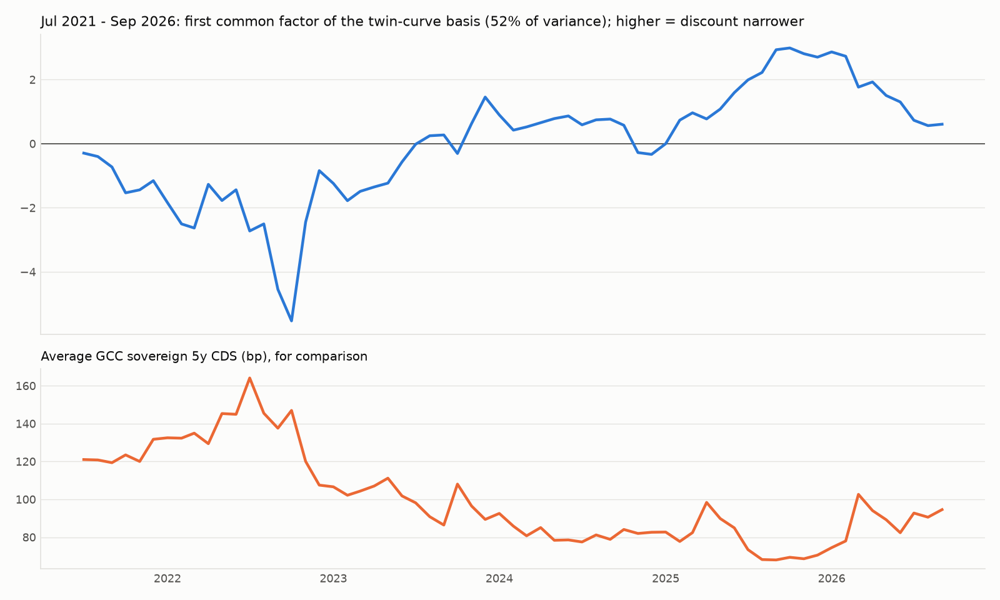

# Drivers of the sukuk discount: funding, supply and a common factor

Generated 2026-10-29.

## New variables

- **Interbank spread (bp):** local 3-month fixing minus the 3-month US Treasury bill (SAIBOR `SASAR3MD=`, EIBOR `DXAED3MD=`, QIBOR `QAQAR3MD=`, BHIBOR `BHIBOR3M=`, KIBOR `KIBOR3M=`, Oman `OMOMR3MD=CBOX`). All six currencies are pegged to the USD (Kuwait to a basket), so the spread measures local funding tightness for the banks that hold most sukuk. Matched to issuers by country of risk. Kuwait is left out of the GCC average because of its basket peg.
- **Sukuk issuance:** USD sukuk issued by country of risk, from the security universe (one line per bond), trailing 12 months, in logs. Also the sukuk share of all USD bond issuance. **USD only:** local-currency sukuk (large in Saudi Arabia) are not in the universe.
- **Global controls:** monthly Brent, VIX, 10-year US Treasury yield.

### Interbank spread by year (bp)

| year | Bahrain | Kuwait | Oman | Qatar | Saudi Arabia | United Arab Emirates |
|---|---|---|---|---|---|---|
| 2016 | 148.0 | 126.0 |  | 123.0 | 175.0 | 84.0 |
| 2017 | 140.0 | 72.0 | 69.0 | 128.0 | 87.0 | 57.0 |
| 2018 | 137.0 | 4.0 | 40.0 | 73.0 | 49.0 | 47.0 |
| 2019 | 119.0 | 51.0 | 75.0 | 62.0 | 53.0 | 47.0 |
| 2020 | 191.0 | 225.0 | 231.0 | 98.0 | 82.0 | 59.0 |
| 2021 | 160.0 | 258.0 | 230.0 | 104.0 | 77.0 | 32.0 |
| 2022 | 142.0 | 58.0 | 75.0 | 13.0 | 109.0 | 23.0 |
| 2023 | 130.0 | -257.0 | 37.0 | 61.0 | 74.0 | -4.0 |
| 2024 | 113.0 | -248.0 | 51.0 | 62.0 | 91.0 | -10.0 |
| 2025 | 135.0 | -154.0 | 43.0 | 36.0 | 114.0 | -6.0 |
| 2026 | 135.0 | -117.0 | 49.0 | 25.0 | 110.0 | 4.0 |

### USD sukuk issuance by year (bn)

| year | Bahrain | Kuwait | Oman | Qatar | Saudi Arabia | United Arab Emirates |
|---|---|---|---|---|---|---|
| 2010 | 0.0 | 0.0 |  | 0.8 | 1.0 | 1.2 |
| 2011 | 1.0 | 0.0 |  | 0.2 | 0.8 | 2.0 |
| 2012 | 0.0 | 0.0 |  | 3.4 | 2.0 | 5.4 |
| 2013 | 0.0 | 0.0 | 0.0 | 1.2 | 2.8 | 4.2 |
| 2014 | 0.6 | 0.0 | 0.0 | 0.0 | 5.5 | 5.0 |
| 2015 | 0.0 | 0.0 | 0.0 | 0.8 | 1.0 | 5.3 |
| 2016 | 0.0 | 0.4 | 0.0 | 1.2 | 3.0 | 5.6 |
| 2017 | 1.2 | 0.0 | 0.5 | 0.0 | 4.6 | 1.4 |
| 2018 | 1.0 | 0.0 | 1.5 | 0.2 | 3.7 | 3.6 |
| 2019 | 1.0 | 0.5 | 0.0 | 1.0 | 6.1 | 8.6 |
| 2020 | 3.0 | 1.0 | 0.0 | 2.6 | 8.7 | 10.2 |
| 2021 | 2.7 | 2.1 | 1.8 | 0.6 | 14.1 | 4.0 |
| 2022 | 1.4 | 0.5 | 0.0 | 0.3 | 7.2 | 4.9 |
| 2023 | 1.8 | 0.0 | 1.0 | 2.5 | 20.0 | 6.9 |
| 2024 | 3.2 | 3.0 | 2.5 | 3.1 | 25.0 | 8.6 |
| 2025 | 4.2 | 2.9 | 1.8 | 4.9 | 37.0 | 17.6 |
| 2026 | 0.8 | 1.5 | 0.8 | 1.2 | 23.3 | 4.9 |

## Panel regressions (issuer fixed effects)

`coef_per_1sd_bp` = change in basis (bp) for a one-standard-deviation rise in the variable, so variables can be compared. CDS per 100bp = coef_raw x 100. Same sample in every row.

| model | variable | coef_per_1sd_bp | coef_raw | t_cluster_issuer | t_driscoll_kraay | n_obs | issuers |
|---|---|---|---|---|---|---|---|
| CDS + liquidity (baseline, same sample) | cds | -21.6 | -0.221 | -5.19 | -5.89 | 848 | 16 |
| CDS + liquidity (baseline, same sample) | liq_gap | -6.9 | -0.813 | -4.11 | -4.83 | 848 | 16 |
| + interbank spread | cds | -23.6 | -0.242 | -5.17 | -4.73 | 848 | 16 |
| + interbank spread | liq_gap | -7.0 | -0.815 | -4.14 | -4.85 | 848 | 16 |
| + interbank spread | ib_spread | 3.4 | 0.058 | 1.1 | 0.83 | 848 | 16 |
| + sukuk issuance (log, 12m) | cds | -20.7 | -0.212 | -4.93 | -5.38 | 848 | 16 |
| + sukuk issuance (log, 12m) | liq_gap | -6.8 | -0.801 | -4.07 | -4.57 | 848 | 16 |
| + sukuk issuance (log, 12m) | log_sukuk_12m | 5.4 | 5.565 | 1.52 | 1.59 | 848 | 16 |
| + sukuk share of issuance (12m) | cds | -20.7 | -0.212 | -4.61 | -4.83 | 848 | 16 |
| + sukuk share of issuance (12m) | liq_gap | -7.0 | -0.822 | -4.1 | -4.89 | 848 | 16 |
| + sukuk share of issuance (12m) | sukuk_share_12m | 1.7 | 8.267 | 1.21 | 0.69 | 848 | 16 |
| + interbank + issuance + global (Brent, VIX, UST10y) | cds | -24.4 | -0.249 | -6.75 | -4.57 | 848 | 16 |
| + interbank + issuance + global (Brent, VIX, UST10y) | liq_gap | -7.4 | -0.866 | -3.91 | -4.61 | 848 | 16 |
| + interbank + issuance + global (Brent, VIX, UST10y) | ib_spread | 1.9 | 0.032 | 0.48 | 0.45 | 848 | 16 |
| + interbank + issuance + global (Brent, VIX, UST10y) | log_sukuk_12m | 4.4 | 4.504 | 0.97 | 0.95 | 848 | 16 |
| + interbank + issuance + global (Brent, VIX, UST10y) | brent | -6.7 | -0.408 | -1.68 | -3.35 | 848 | 16 |
| + interbank + issuance + global (Brent, VIX, UST10y) | vix | -2.2 | -0.396 | -0.83 | -1.3 | 848 | 16 |
| + interbank + issuance + global (Brent, VIX, UST10y) | ust10y | -1.6 | -1.323 | -0.29 | -0.54 | 848 | 16 |
| + interbank + issuance, month FE (global absorbed) | cds | -32.7 | -0.334 | -9.0 | -5.37 | 848 | 16 |
| + interbank + issuance, month FE (global absorbed) | liq_gap | -5.7 | -0.671 | -2.39 | -2.76 | 848 | 16 |
| + interbank + issuance, month FE (global absorbed) | ib_spread | 4.5 | 0.076 | 1.77 | 1.17 | 848 | 16 |
| + interbank + issuance, month FE (global absorbed) | log_sukuk_12m | -2.1 | -2.184 | -0.21 | -0.31 | 848 | 16 |

## Common factor (PCA on the issuer-by-month basis)

Each column (issuer) is demeaned and standardized, so every issuer counts equally and only movements over time matter. The panel must be balanced, so only issuers observed in at least 90% of months enter (short gaps of up to 2 months are interpolated). *Changes* runs the PCA on monthly changes, which avoids trends driving the result.

> **Sukuk issuance is not a finding.** In levels, GCC sukuk issuance looks like the strongest single driver of the factor (t of about 8 to 10). In monthly changes the effect is zero, and in the issuer panel it is insignificant and flips sign with month fixed effects. Both series trend over 2021-2026, so the levels result is most likely a shared trend, not a supply effect. Do not cite it as evidence.

### Main: Jul 2021 - Sep 2026: 6 issuers, 63 months

Issuers: BAPCO Energies BSCC Closed; Bahrain, Kingdom of (Government); Oman, Sultanate of (Government); Saudi Arabia, Kingdom of (Government); Saudi Arabian Oil Co; Sharjah, Emirate Of

| component | variance_share_levels | variance_share_changes |
|---|---|---|
| PC1 | 0.52 | 0.37 |
| PC2 | 0.29 | 0.2 |
| PC3 | 0.11 | 0.15 |
| PC4 | 0.04 | 0.12 |

PC1 loadings (levels / changes):

| issuer | PC1_levels | PC1_changes |
|---|---|---|
| BAPCO Energies BSCC Closed | 0.5 | 0.37 |
| Bahrain, Kingdom of (Government) | 0.53 | 0.53 |
| Oman, Sultanate of (Government) | 0.51 | 0.52 |
| Saudi Arabia, Kingdom of (Government) | 0.24 | 0.29 |
| Saudi Arabian Oil Co | 0.22 | 0.21 |
| Sharjah, Emirate Of | 0.34 | 0.43 |

What moves PC1? Coefficients are per one standard deviation of each driver (Newey-West t, 3 lags). A positive coefficient means the driver narrows the discount (moves the basis toward zero).

**Levels:**

| specification | driver | coef_per_1sd | t_nw | r2 | months |
|---|---|---|---|---|---|
| single driver | brent | -0.922 | -3.21 | 0.27 | 63 |
| single driver | vix | -0.993 | -3.12 | 0.31 | 63 |
| single driver | ust10y | 0.894 | 3.73 | 0.25 | 63 |
| single driver | dxy | -0.608 | -1.23 | 0.12 | 63 |
| single driver | cds_avg | -1.516 | -7.39 | 0.73 | 63 |
| single driver | ib_spread_avg | -0.092 | -0.19 | 0.0 | 63 |
| single driver | log_gcc_sukuk_12m | 1.531 | 8.2 | 0.75 | 63 |
| all drivers | brent | -0.031 | -0.28 | 0.89 | 63 |
| all drivers | vix | -0.08 | -0.53 | 0.89 | 63 |
| all drivers | ust10y | 0.629 | 1.91 | 0.89 | 63 |
| all drivers | dxy | -0.628 | -3.24 | 0.89 | 63 |
| all drivers | cds_avg | -0.679 | -2.05 | 0.89 | 63 |
| all drivers | ib_spread_avg | 0.171 | 0.79 | 0.89 | 63 |
| all drivers | log_gcc_sukuk_12m | 0.474 | 2.82 | 0.89 | 63 |

**Monthly changes:**

| specification | driver | coef_per_1sd | t_nw | r2 | months |
|---|---|---|---|---|---|
| single driver | brent | -0.314 | -1.62 | 0.04 | 62 |
| single driver | vix | -0.592 | -1.93 | 0.16 | 62 |
| single driver | ust10y | -0.565 | -1.86 | 0.14 | 62 |
| single driver | dxy | -0.833 | -2.62 | 0.31 | 62 |
| single driver | cds_avg | -0.825 | -3.74 | 0.31 | 62 |
| single driver | ib_spread_avg | 0.769 | 2.09 | 0.27 | 62 |
| single driver | log_gcc_sukuk_12m | -0.108 | -0.5 | 0.01 | 62 |
| all drivers | brent | -0.106 | -0.65 | 0.56 | 62 |
| all drivers | vix | -0.179 | -0.94 | 0.56 | 62 |
| all drivers | ust10y | -0.019 | -0.08 | 0.56 | 62 |
| all drivers | dxy | -0.435 | -3.9 | 0.56 | 62 |
| all drivers | cds_avg | -0.432 | -2.88 | 0.56 | 62 |
| all drivers | ib_spread_avg | 0.466 | 2.56 | 0.56 | 62 |
| all drivers | log_gcc_sukuk_12m | -0.107 | -0.66 | 0.56 | 62 |

### Robustness: Jan 2023 - Sep 2026: 8 issuers, 41 months

Issuers: BAPCO Energies BSCC Closed; Bahrain, Kingdom of (Government); Banque Saudi Fransi SJSC; First Abu Dhabi Bank PJSC; Oman, Sultanate of (Government); Saudi Arabia, Kingdom of (Government); Saudi Arabian Oil Co; Sharjah, Emirate Of

| component | variance_share_levels | variance_share_changes |
|---|---|---|
| PC1 | 0.48 | 0.23 |
| PC2 | 0.18 | 0.21 |
| PC3 | 0.15 | 0.16 |
| PC4 | 0.08 | 0.11 |

PC1 loadings (levels / changes):

| issuer | PC1_levels | PC1_changes |
|---|---|---|
| BAPCO Energies BSCC Closed | 0.23 | -0.01 |
| Bahrain, Kingdom of (Government) | 0.35 | 0.41 |
| Banque Saudi Fransi SJSC | 0.4 | -0.2 |
| First Abu Dhabi Bank PJSC | 0.4 | -0.33 |
| Oman, Sultanate of (Government) | 0.34 | 0.34 |
| Saudi Arabia, Kingdom of (Government) | 0.42 | 0.34 |
| Saudi Arabian Oil Co | 0.46 | -0.25 |
| Sharjah, Emirate Of | 0.06 | 0.63 |

What moves PC1? Coefficients are per one standard deviation of each driver (Newey-West t, 3 lags). A positive coefficient means the driver narrows the discount (moves the basis toward zero).

**Levels:**

| specification | driver | coef_per_1sd | t_nw | r2 | months |
|---|---|---|---|---|---|
| single driver | brent | -0.583 | -1.04 | 0.09 | 41 |
| single driver | vix | 0.646 | 1.77 | 0.11 | 41 |
| single driver | ust10y | -0.002 | -0.0 | 0.0 | 41 |
| single driver | dxy | -1.355 | -3.66 | 0.48 | 41 |
| single driver | cds_avg | -1.117 | -3.1 | 0.32 | 41 |
| single driver | ib_spread_avg | 1.033 | 2.69 | 0.28 | 41 |
| single driver | log_gcc_sukuk_12m | 1.754 | 10.34 | 0.8 | 41 |
| all drivers | brent | 0.056 | 0.37 | 0.87 | 41 |
| all drivers | vix | 0.139 | 0.87 | 0.87 | 41 |
| all drivers | ust10y | -0.286 | -1.28 | 0.87 | 41 |
| all drivers | dxy | -0.379 | -2.13 | 0.87 | 41 |
| all drivers | cds_avg | -0.342 | -1.58 | 0.87 | 41 |
| all drivers | ib_spread_avg | 0.002 | 0.01 | 0.87 | 41 |
| all drivers | log_gcc_sukuk_12m | 1.372 | 3.81 | 0.87 | 41 |

**Monthly changes:**

| specification | driver | coef_per_1sd | t_nw | r2 | months |
|---|---|---|---|---|---|
| single driver | brent | -0.191 | -1.12 | 0.02 | 40 |
| single driver | vix | -0.421 | -1.56 | 0.1 | 40 |
| single driver | ust10y | -0.382 | -1.43 | 0.08 | 40 |
| single driver | dxy | -0.385 | -1.82 | 0.08 | 40 |
| single driver | cds_avg | -0.675 | -3.53 | 0.25 | 40 |
| single driver | ib_spread_avg | 0.264 | 1.47 | 0.04 | 40 |
| single driver | log_gcc_sukuk_12m | 0.11 | 0.42 | 0.01 | 40 |
| all drivers | brent | 0.201 | 1.68 | 0.33 | 40 |
| all drivers | vix | 0.079 | 0.36 | 0.33 | 40 |
| all drivers | ust10y | 0.018 | 0.07 | 0.33 | 40 |
| all drivers | dxy | -0.343 | -2.95 | 0.33 | 40 |
| all drivers | cds_avg | -0.746 | -3.06 | 0.33 | 40 |
| all drivers | ib_spread_avg | 0.128 | 0.95 | 0.33 | 40 |
| all drivers | log_gcc_sukuk_12m | 0.087 | 0.31 | 0.33 | 40 |

## Caveats

- The PCA uses 6 issuers (8 in the robustness window) over about 5 years, so it shows whether there is a common component, not a precise decomposition.
- Level regressions on trending series (CDS fell a lot after 2022) can show spurious relationships. Read the changes regressions as the stricter test.
- The issuance variable covers USD issuance only, and its levels relationship with the factor is a shared trend (see the note above).
- Interbank fixings are matched by country, so Abu Dhabi, Dubai and Sharjah issuers share EIBOR.
