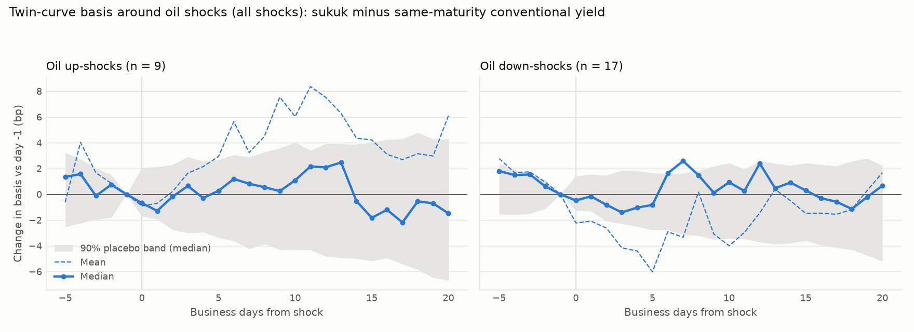
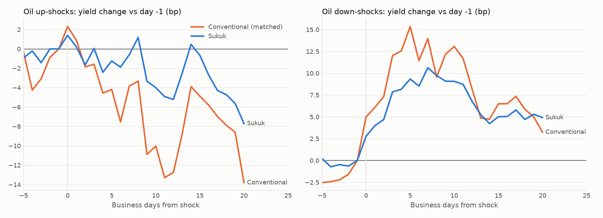
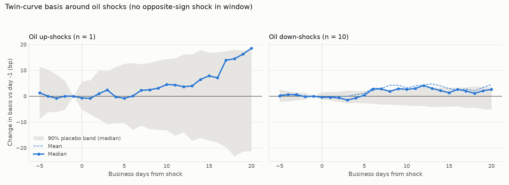

# Oil shocks and the twin curves: event study

Generated 2026-10-29. Shock rule: Brent front-month 1-day move, net of S&P 500 (rolling beta), |z| >= 3 vs trailing 250 days AND raw move >= 5%; up/down selected separately, 20 business days apart (oil_shocks_z3_min5pct_h1.csv).

## Design

- **Window:** 5 business days before to 20 after each shock (day 0 = shock day). Each matched sukuk's change is measured against its own last observation before the shock (day -1 or earlier, down to day -5).
- **Measures (bp):** *basis* = sukuk yield minus the issuer's conventional yield interpolated at the same maturity; *sukuk leg* = the sukuk's own yield; *conventional leg* = that matched conventional yield. Basis change = sukuk leg change minus conventional leg change.
- **Aggregation:** bonds, then issuer mean, then shock mean, then the mean across shocks. Each shock counts once.
- **Inference:** *t* uses the cross-shock standard error of the mean. Because a few 2020 shocks dominate the means (see shock by shock), the main test uses the **median across shocks**, the count of shocks with a negative change, and a volatility-matched placebo. For the placebo, up to 1,000 random business days at least 25 business days from any shock are sorted into quintiles of trailing 20-day Brent volatility. Each bootstrap draw (4,000) pairs every shock with a placebo day from its own volatility quintile and takes the median. Matching matters: shocks cluster in turbulent markets (no shock falls in the calmest quintile, 12 of 26 in the most volatile). The grey band in the charts is the matched placebo's 90% range for the median.
- **Pass-through:** the slope of the sukuk-leg change on the conventional-leg change, across issuer-shocks, compared with the same slope on normal days (non-overlapping 5- and 20-day changes away from shocks). A slope of 1 means the curves move together one for one. Below 1, sukuk are a damped version of the conventional curve.
- **Pooled:** all shocks together, with down-shock changes multiplied by -1. It reads as the response to an oil-price *rise* and tests one hypothesis with all 26 shocks: does the basis move with oil? This assumes up and down responses are symmetric, which the separate rows let you check.
- **Robustness:** (1) *clean* subset: shocks with no opposite-sign shock inside the window; (2) *episodes*: shocks less than 20 business days apart are chained, and the net change runs from before the first shock to 20 days after the last.

## Key findings (computed)

- **Oil down-shocks, +5 days:** basis mean -6.0bp, median -0.8bp, negative in 11/17 shocks, placebo p (median) 0.71; excluding 2020: mean +0.6bp, median -0.6bp.
- **Oil down-shocks, +20 days:** basis mean +1.7bp, median +0.7bp, negative in 7/17 shocks, placebo p (median) 0.34; excluding 2020: mean +3.9bp, median +0.8bp.
- **Oil up-shocks, +5 days:** basis mean +2.9bp, median +0.3bp, negative in 4/9 shocks, placebo p (median) 0.73; excluding 2020: mean -1.1bp, median -0.8bp.
- **Oil up-shocks, +20 days:** basis mean +6.1bp, median -1.5bp, negative in 5/9 shocks, placebo p (median) 0.86; excluding 2020: mean +0.1bp, median -1.8bp.
- **Pass-through at 5 days:** sukuk move 0.64bp per 1bp of the matched conventional yield after shocks (ex-2020) vs 0.61 on normal days; difference +0.03, 90% CI [-0.06, 0.16].
- **Pass-through at 20 days:** sukuk move 0.66bp per 1bp of the matched conventional yield after shocks (ex-2020) vs 0.77 on normal days; difference -0.11, 90% CI [-0.20, 0.04].
- **Minimum detectable effect (80% power, two-sided 5%, median across shocks):** up +5d: 5.4bp; up +20d: 9.3bp; down +5d: 3.9bp; down +20d: 6.0bp; pooled +5d: 3.1bp; pooled +20d: 4.9bp. Smaller true median basis responses than these could go undetected. The pooled figure is per oil-price *rise* (down-shocks sign-flipped).

## How the twin curves co-move: pass-through, shocks vs normal days

| horizon_days | sample | n_shock | beta_shock | corr_shock | n_normal | beta_normal | corr_normal | diff | diff_ci90 |
|---|---|---|---|---|---|---|---|---|---|
| 5 | All shocks | 204 | 0.68 | 0.95 | 2897 | 0.61 | 0.73 | 0.07 | [-0.03, 0.21] |
| 5 | Shocks ex-2020 | 185 | 0.64 | 0.81 | 2897 | 0.61 | 0.73 | 0.03 | [-0.06, 0.16] |
| 5 | 2020 shocks only | 19 | 0.69 | 0.97 | 2897 | 0.61 | 0.73 | 0.08 | [-0.04, 0.25] |
| 20 | All shocks | 203 | 0.69 | 0.94 | 717 | 0.77 | 0.87 | -0.08 | [-0.15, -0.00] |
| 20 | Shocks ex-2020 | 183 | 0.66 | 0.83 | 717 | 0.77 | 0.87 | -0.11 | [-0.20, 0.04] |
| 20 | 2020 shocks only | 20 | 0.7 | 0.98 | 717 | 0.77 | 0.87 | -0.07 | [-0.14, 0.03] |

## Main results (all shocks)

| shock | tau | n_shocks | issuer_shocks | basis mean | basis median | basis <0 | basis t (mean) | basis placebo p (median) | basis MDE 80% (bp) | Sukuk leg mean | Sukuk leg median | Conventional leg mean | Conventional leg median |
|---|---|---|---|---|---|---|---|---|---|---|---|---|---|
| up | 0 | 9 | 74 | -0.9 | -0.7 | 6/9 | -0.59 | 0.529 | 3.2 | 1.4 | 3.3 | 2.3 | 5.5 |
| up | 1 | 9 | 77 | -0.7 | -1.3 | 6/9 | -0.65 | 0.263 | 3.5 | 0.2 | 1.4 | 0.9 | 3.3 |
| up | 5 | 9 | 76 | 2.9 | 0.3 | 4/9 | 1.0 | 0.73 | 5.4 | -1.2 | 0.1 | -4.2 | 1.3 |
| up | 10 | 9 | 77 | 6.0 | 1.1 | 4/9 | 1.01 | 0.549 | 7.2 | -4.0 | -1.2 | -10.0 | 6.3 |
| up | 20 | 9 | 76 | 6.1 | -1.5 | 5/9 | 0.89 | 0.865 | 9.3 | -7.7 | 1.7 | -13.8 | 9.8 |
| down | 0 | 17 | 131 | -2.2 | -0.5 | 12/17 | -1.43 | 0.572 | 2.4 | 2.8 | 1.7 | 5.0 | 0.6 |
| down | 1 | 17 | 129 | -2.1 | -0.2 | 9/17 | -1.28 | 0.774 | 2.4 | 4.0 | -0.2 | 6.1 | 1.3 |
| down | 5 | 17 | 128 | -6.0 | -0.8 | 11/17 | -1.17 | 0.712 | 3.9 | 9.3 | -3.1 | 15.4 | -0.2 |
| down | 10 | 17 | 129 | -4.0 | 0.9 | 8/17 | -0.67 | 0.364 | 5.1 | 9.1 | -8.8 | 13.1 | -8.2 |
| down | 20 | 17 | 127 | 1.7 | 0.7 | 7/17 | 0.29 | 0.336 | 6.0 | 4.9 | -2.4 | 3.2 | -7.5 |
| pooled | 0 | 26 | 205 | 1.1 | 0.3 | 11/26 | 0.98 | 0.632 | 1.9 | -1.3 | 1.2 | -2.5 | 0.3 |
| pooled | 1 | 26 | 206 | 1.1 | -0.7 | 14/26 | 0.98 | 0.238 | 1.9 | -2.5 | 1.1 | -3.7 | 0.5 |
| pooled | 5 | 26 | 204 | 4.9 | 0.6 | 10/26 | 1.42 | 0.634 | 3.1 | -6.5 | 2.9 | -11.5 | 0.8 |
| pooled | 10 | 26 | 206 | 4.7 | -0.3 | 13/26 | 1.09 | 0.652 | 4.1 | -7.3 | 5.0 | -12.0 | 6.8 |
| pooled | 20 | 26 | 203 | 1.0 | -0.8 | 15/26 | 0.23 | 0.456 | 4.9 | -5.9 | 2.1 | -6.9 | 8.4 |

## Robustness 0: excluding 2020

21 shocks (7 up, 14 down).

| shock | tau | n_shocks | issuer_shocks | basis mean | basis median | basis <0 | basis t (mean) | basis placebo p (median) | basis MDE 80% (bp) | Sukuk leg mean | Sukuk leg median | Conventional leg mean | Conventional leg median |
|---|---|---|---|---|---|---|---|---|---|---|---|---|---|
| up | 0 | 7 | 66 | -0.8 | -0.7 | 5/7 | -1.27 | 0.537 | 3.5 | 2.9 | 3.3 | 3.8 | 5.5 |
| up | 1 | 7 | 69 | -0.9 | -1.3 | 5/7 | -0.69 | 0.322 | 4.0 | 2.9 | 1.5 | 3.8 | 4.8 |
| up | 5 | 7 | 68 | -1.1 | -0.8 | 4/7 | -1.03 | 0.733 | 5.9 | 5.9 | 4.2 | 7.0 | 2.7 |
| up | 10 | 7 | 69 | -1.7 | -2.6 | 4/7 | -0.99 | 0.402 | 7.9 | 10.9 | 4.5 | 12.7 | 7.4 |
| up | 20 | 7 | 68 | 0.1 | -1.8 | 4/7 | 0.02 | 0.732 | 10.7 | 12.6 | 8.8 | 12.5 | 10.8 |
| down | 0 | 14 | 119 | 0.0 | -0.3 | 9/14 | 0.03 | 0.683 | 2.5 | -0.3 | 0.6 | -0.3 | 0.5 |
| down | 1 | 14 | 117 | 0.0 | 0.2 | 7/14 | 0.0 | 0.774 | 2.7 | -1.0 | -0.7 | -1.0 | 0.6 |
| down | 5 | 14 | 117 | 0.6 | -0.6 | 8/14 | 0.33 | 0.866 | 4.0 | -3.7 | -3.7 | -4.3 | -2.1 |
| down | 10 | 14 | 117 | 1.4 | 0.3 | 7/14 | 0.69 | 0.661 | 5.4 | -7.3 | -10.0 | -8.7 | -9.5 |
| down | 20 | 14 | 115 | 3.9 | 0.8 | 6/14 | 1.65 | 0.366 | 6.6 | -5.8 | -2.8 | -9.8 | -8.4 |
| pooled | 0 | 21 | 185 | -0.3 | 0.2 | 10/21 | -0.74 | 0.806 | 2.1 | 1.2 | 1.3 | 1.4 | 0.3 |
| pooled | 1 | 21 | 186 | -0.3 | -0.9 | 12/21 | -0.45 | 0.25 | 2.1 | 1.6 | 1.4 | 1.9 | 2.2 |
| pooled | 5 | 21 | 185 | -0.7 | 0.3 | 10/21 | -0.64 | 0.894 | 3.3 | 4.5 | 4.2 | 5.2 | 2.7 |
| pooled | 10 | 21 | 186 | -1.5 | -0.9 | 11/21 | -1.04 | 0.449 | 4.6 | 8.5 | 8.8 | 10.0 | 8.2 |
| pooled | 20 | 21 | 183 | -2.6 | -0.9 | 12/21 | -1.28 | 0.466 | 5.9 | 8.1 | 3.1 | 10.7 | 9.8 |

## Robustness 1: clean shocks only (no opposite-sign shock in window)

11 of 26 shocks (1 up, 10 down).

| shock | tau | n_shocks | issuer_shocks | basis mean | basis median | basis <0 | basis t (mean) | basis placebo p (median) | basis MDE 80% (bp) | Sukuk leg mean | Sukuk leg median | Conventional leg mean | Conventional leg median |
|---|---|---|---|---|---|---|---|---|---|---|---|---|---|
| up | 0 | 1 | 1 | -0.7 | -0.7 | 1/1 |  | 0.728 | 8.7 | 6.0 | 6.0 | 6.7 | 6.7 |
| up | 1 | 1 | 4 | -0.9 | -0.9 | 1/1 |  | 0.809 | 11.8 | 1.4 | 1.4 | 2.2 | 2.2 |
| up | 5 | 1 | 4 | -0.8 | -0.8 | 1/1 |  | 0.821 | 18.4 | 6.1 | 6.1 | 6.9 | 6.9 |
| up | 10 | 1 | 4 | 4.5 | 4.5 | 0/1 |  | 0.644 | 22.7 | -5.5 | -5.5 | -10.0 | -10.0 |
| up | 20 | 1 | 4 | 18.5 | 18.5 | 0/1 |  | 0.113 | 32.1 | -13.8 | -13.8 | -32.3 | -32.3 |
| down | 0 | 10 | 71 | -0.2 | -0.4 | 7/10 | -0.48 | 0.543 | 2.5 | 0.8 | 2.0 | 1.0 | 0.6 |
| down | 1 | 10 | 69 | -0.2 | -0.4 | 5/10 | -0.16 | 0.665 | 2.8 | 0.5 | -0.0 | 0.7 | 1.4 |
| down | 5 | 10 | 70 | 1.1 | 0.4 | 5/10 | 0.48 | 0.698 | 4.1 | -2.8 | -1.9 | -3.8 | 0.5 |
| down | 10 | 10 | 70 | 3.2 | 2.6 | 4/10 | 1.27 | 0.14 | 5.7 | -5.4 | -6.9 | -8.6 | -11.6 |
| down | 20 | 10 | 67 | 4.5 | 2.6 | 2/10 | 1.65 | 0.217 | 7.5 | -5.2 | -1.0 | -9.7 | -6.9 |
| pooled | 0 | 11 | 72 | 0.1 | 0.4 | 4/11 | 0.32 | 0.605 | 2.5 | -0.1 | -1.7 | -0.3 | -0.5 |
| pooled | 1 | 11 | 73 | 0.1 | -0.6 | 6/11 | 0.08 | 0.443 | 2.8 | -0.3 | 0.2 | -0.4 | -1.3 |
| pooled | 5 | 11 | 74 | -1.1 | -0.8 | 6/11 | -0.52 | 0.525 | 4.2 | 3.1 | 2.7 | 4.1 | 0.2 |
| pooled | 10 | 11 | 74 | -2.5 | -1.6 | 6/11 | -1.05 | 0.328 | 5.8 | 4.4 | 5.1 | 6.9 | 8.2 |
| pooled | 20 | 11 | 71 | -2.4 | -0.9 | 8/11 | -0.75 | 0.564 | 7.6 | 3.4 | -0.4 | 5.9 | 6.2 |

## Robustness 2: multi-shock episodes (net effect)

Linked shocks are chained. Changes run from the last observation before the first shock to the last observation within 20 business days after the last shock. Each issuer counts once per episode. `brent_net_pct` is the Brent move over the same span.

| episode | shocks | brent_net_pct | issuers | d_basis_bp | d_sukuk_bp | d_conv_bp | issuers_basis_down |
|---|---|---|---|---|---|---|---|
| 2019-09-16 to 2019-09-17 | 16Sep+ 17Sep- | -2.2 | 4 | -4.9 | 1.4 | 6.3 | 2 |
| 2020-03-09 to 2020-05-05 | 09Mar- 01Apr+ 21Apr- 05May+ | -13.0 | 4 | -16.9 | 85.9 | 102.8 | 3 |
| 2022-03-01 to 2022-03-09 | 01Mar+ 09Mar- | 0.5 | 9 | 17.4 | 41.6 | 24.3 | 3 |
| 2025-06-13 to 2025-06-23 | 13Jun+ 23Jun- | -1.8 | 12 | 0.9 | -14.2 | -15.1 | 6 |
| 2026-03-06 to 2026-04-29 | 06Mar+ 01Apr- 29Apr+ | 12.7 | 13 | -15.3 | 27.5 | 42.8 | 11 |
| 2026-07-13 to 2026-07-27 | 13Jul+ 27Jul- | 22.3 | 14 | -6.3 | 9.0 | 15.3 | 11 |

## Sovereign vs quasi-sovereign / corporate (+20 days)

| shock | group | n_shocks | issuer_shocks | Basis +20d (bp) | Sukuk leg +20d (bp) | Conventional leg +20d (bp) | basis t |
|---|---|---|---|---|---|---|---|
| up | Quasi-sov / corporate | 5 | 37 | -3.1 | 23.1 | 26.2 | -1.06 |
| up | Sovereign | 9 | 39 | 7.1 | -10.1 | -17.3 | 1.05 |
| down | Quasi-sov / corporate | 9 | 59 | 3.1 | 0.7 | -2.5 | 1.06 |
| down | Sovereign | 17 | 68 | 1.7 | 4.3 | 2.6 | 0.29 |

## Shock by shock

| date | sign | brent_pct | z | overlap | issuers | d_basis_5d | d_basis_20d | d_sukuk_20d | d_conv_20d |
|---|---|---|---|---|---|---|---|---|---|
| 2018-07-11 | down | -6.13 | -4.13 |  | 3 | -4.1 | 17.9 | -2.4 | -20.3 |
| 2018-11-20 | down | -7.06 | -4.22 |  | 4 | -3.9 | 4.4 | -3.1 | -7.5 |
| 2018-12-26 | up | 8.3 | 3.23 |  | 4 | -0.8 | 18.5 | -13.8 | -32.3 |
| 2019-06-03 | down | -5.7 | -3.18 |  | 4 | 16.4 | 16.9 | -30.6 | -47.4 |
| 2019-08-01 | down | -6.55 | -3.35 |  | 4 | -8.0 | -10.9 | -40.8 | -29.9 |
| 2019-09-16 | up | 12.13 | 6.84 | yes | 4 | -3.6 | -8.1 | 1.7 | 9.8 |
| 2019-09-17 | down | -5.84 | -3.06 | yes | 4 | -2.7 | -2.6 | -1.8 | 0.8 |
| 2020-02-03 | down | -7.1 | -4.38 |  | 4 | -0.3 | 0.2 | 9.5 | 9.3 |
| 2020-03-09 | down | -30.86 | -12.59 | yes | 4 | -80.7 | -74.5 | 252.6 | 327.1 |
| 2020-04-01 | up | 11.98 | 5.62 | yes | 4 | 11.1 | -1.5 | -79.2 | -77.7 |
| 2020-04-21 | down | -29.27 | -7.56 | yes | 4 | -29.0 | 47.5 | -97.1 | -144.6 |
| 2020-05-05 | up | 13.4 | 3.06 | yes | 4 | 22.9 | 55.7 | -78.3 | -134.0 |
| 2021-11-26 | down | -12.08 | -5.8 |  | 8 | -4.3 | 0.7 | 2.0 | 1.4 |
| 2022-03-01 | up | 6.28 | 3.7 | yes | 9 | -1.2 | 8.1 | 37.7 | 29.7 |
| 2022-03-09 | down | -14.04 | -7.19 | yes | 9 | 3.4 | 18.6 | 41.5 | 22.9 |
| 2022-08-01 | down | -9.58 | -3.35 |  | 9 | 8.6 | -0.9 | -14.0 | -13.1 |
| 2023-10-04 | down | -5.66 | -3.16 |  | 11 | 3.7 | 9.5 | 17.0 | 7.5 |
| 2024-10-28 | down | -5.18 | -3.13 |  | 12 | 1.6 | 0.9 | 10.5 | 9.6 |
| 2025-06-13 | up | 6.65 | 4.15 | yes | 12 | 1.6 | 1.0 | -9.3 | -10.3 |
| 2025-06-23 | down | -9.02 | -5.04 | yes | 12 | -0.3 | -0.7 | -18.4 | -17.7 |
| 2026-02-02 | down | -6.41 | -3.52 |  | 13 | 1.0 | 6.6 | 0.4 | -6.2 |
| 2026-03-06 | up | 10.15 | 5.27 | yes | 13 | -5.8 | -7.3 | 54.0 | 61.2 |
| 2026-04-01 | down | -16.57 | -6.82 | yes | 13 | -2.9 | -0.2 | -27.5 | -27.3 |
| 2026-04-29 | up | 8.99 | 3.26 | yes | 13 | 2.0 | -1.8 | 9.1 | 10.8 |
| 2026-07-13 | up | 10.23 | 3.24 | yes | 14 | 0.3 | -9.7 | 8.8 | 18.5 |
| 2026-07-27 | down | -11.69 | -3.87 | yes | 14 | -0.8 | -4.8 | -14.0 | -9.2 |

## Reading the results

- A **negative basis change** means the sukuk yield fell relative to the issuer's conventional curve, or rose less: sukuk outperformed. A positive change means sukuk underperformed.
- The legs show *which* curve moved. Both legs also include moves in US Treasury yields, which cancel in the basis.

## Caveats

- Few shocks (9 up, 17 down), and only 3-4 issuers before 2021. Pre-2021 shocks rest mainly on KSA, Bahrain, Oman and Dubai.
- Shocks are defined from price moves, so anticipated events (pre-announced OPEC cuts) are not included by design.
- Some geopolitical episodes produce shocks of both signs within weeks (Russia-Ukraine 2022, Israel-Iran 2025, 2020, 2026). Each is treated as a separate surprise, with the clean-subset and episode checks above.
- The basis inherits the twin-curve caveats: linear interpolation, mid yields, and matching by obligor name.

Files: `event_key_main.csv`, `event_key_clean.csv`, `event_per_shock.csv`, `event_episodes.csv`, `event_paths_up.csv`, `event_paths_down.csv`, `event_bond_paths.parquet`.
