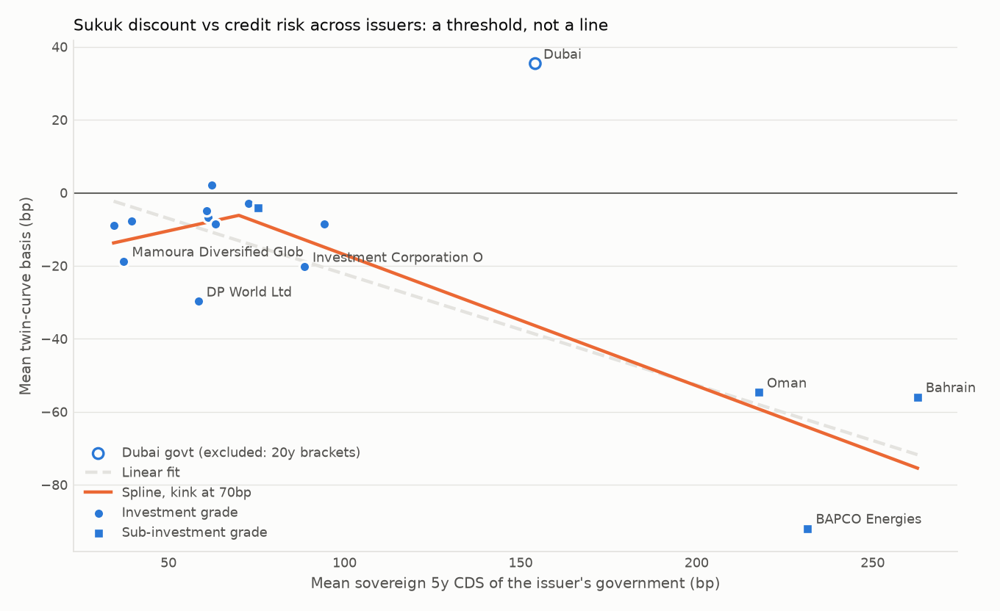
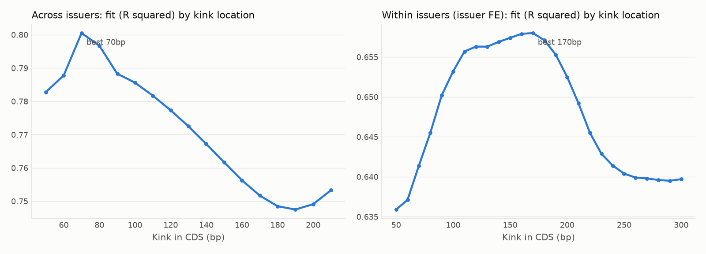

# Mechanism, threshold and inference

Generated 2026-10-29. Bootstrap: restricted wild cluster bootstrap-t, Webb six-point weights, 9,999 draws, clustered by government (6 CDS series) and by issuer. Coefficients are bp of basis per 100bp of sovereign CDS unless stated.

## 1a. Sukuk structure

Seniority: {'Senior Unsecured': 2425}. Every twin sukuk is senior unsecured, so seniority cannot separate anything.

**All twin sukuk (bond-level mean basis):**

| structure | sukuk | mean_basis_bp | median_basis_bp |
|---|---|---|---|
| Hybrid Sukuk | 43 | -21.6 | -8.8 |
| Ijara | 10 | -18.9 | -10.9 |
| Wakala bil istithmar | 8 | -9.7 | -8.1 |
| Murabaha | 6 | -16.7 | -6.7 |
| Other Sukuk | 1 | -52.2 | -52.2 |

**Within issuers that use more than one structure** (`vs_issuer_mean_bp` = the structure's mean basis minus the issuer's mean, so issuer credit is held fixed):

| parent_name | structure | sukuk | mean_basis_bp | vs_issuer_mean_bp |
|---|---|---|---|---|
| Arab Energy Fund | Hybrid Sukuk | 1 | 7.9 | 8.0 |
| Arab Energy Fund | Murabaha | 1 | -8.1 | -8.0 |
| Bahrain, Kingdom of (Government) | Hybrid Sukuk | 9 | -46.5 | 3.4 |
| Bahrain, Kingdom of (Government) | Ijara | 1 | -58.6 | -8.7 |
| Bahrain, Kingdom of (Government) | Murabaha | 1 | -69.7 | -19.8 |
| Bahrain, Kingdom of (Government) | Other Sukuk | 1 | -52.2 | -2.3 |
| Saudi Arabia, Kingdom of (Government) | Hybrid Sukuk | 11 | -3.3 | -0.2 |
| Saudi Arabia, Kingdom of (Government) | Ijara | 3 | -2.4 | 0.7 |
| Saudi Arabian Oil Co | Hybrid Sukuk | 3 | -0.5 | 2.6 |
| Saudi Arabian Oil Co | Murabaha | 3 | -5.8 | -2.6 |

## 1b-1c. Mechanism regressions

Bond-month regressions use each sukuk's monthly mean basis and remaining maturity, with issuer fixed effects. Interaction terms are centred (maturity at its sample mean, interbank spread at its mean).

| model | term | coef_bp | t_cluster_issuer | n_obs | issuers | p_wild_government | p_wild_issuer | note |
|---|---|---|---|---|---|---|---|---|
| 1a. Bond-month: CDS x Ijara (asset-backed) | cds100:ijara | 10.88 | 1.47 | 2203 | 16 | 0.718 | 0.454 |  |
| 1a. Bond-month: CDS slope (same sample) | cds100 | -29.26 | -5.59 | 2203 | 16 | 0.318 | 0.082 | slope for non-Ijara sukuk |
| 1b. Bond-month: CDS x remaining maturity (per year) | cds100:tau_c | -2.09 | -1.95 | 2203 | 16 | 0.046 | 0.027 |  |
| 1b. Bond-month: CDS slope at mean maturity | cds100 | -20.47 | -9.49 | 2203 | 16 | 0.299 | 0.1 | mean remaining maturity 5.4y |
| 1c. Issuer-month: CDS x interbank spread (per bp) | cds100:ib_c | -0.1 | -2.74 | 850 | 16 | 0.313 | 0.184 |  |
| 1c. Issuer-month: CDS slope at mean interbank spread | cds100 | -16.14 | -2.72 | 850 | 16 | 0.339 | 0.139 |  |
| 1c. Issuer-month: liquidity gap (bp basis per bp bid-ask) | liq_gap | -0.81 | -4.12 | 850 | 16 | 0.019 | 0.019 |  |

How to read the predictions:
- **Recovery / asset backing:** an Ijara sukuk is backed by a tangible asset, so if investors price recovery value the discount should *steepen* with CDS for Ijara (CDS x Ijara < 0).
- **Default / recovery over time:** expected loss accumulates with maturity, so the CDS slope should grow with tenor (CDS x maturity < 0).
- **Captive demand:** if local Islamic banks are the marginal buyer, tight local funding (a wider interbank spread) should *weaken* the discount (CDS x interbank > 0). The negative liquidity-gap coefficient fits the same story: sukuk that trade less are held to maturity by these banks and price richer, which is the opposite of a liquidity premium.

## 2. Threshold shape

Ratings are a **snapshot as of the export**, not a history. The Oman sovereign shows Baa3 (investment grade) after its 2024 upgrades, but it was rated below investment grade for most of the sample, so a variant counts it as sub-IG. The CDS spline does not need ratings because CDS varies over time.

| parent_name | rating_snapshot | sub_ig | sub_ig_oman | cds | basis | months |
|---|---|---|---|---|---|---|
| First Abu Dhabi Bank PJSC | Aa3 | False | False | 39.5 | -7.7 | 49 |
| Dubai Aerospace Enterprise (DAE) Ltd | Baa2 | False | False | 94.2 | -8.6 | 39 |
| Arab Energy Fund | Aa2 | False | False |  | -1.5 | 12 |
| Saudi Arabia, Kingdom of (Government) | Aa3 | False | False | 72.7 | -2.8 | 115 |
| Saudi Arabian Oil Co | Aa3 | False | False | 61.2 | -6.8 | 65 |
| Bahrain, Kingdom of (Government) | B2 | True | True | 262.7 | -55.9 | 110 |
| The Saudi National Bank SJSC | Aa3 | False | False | 60.7 | -4.9 | 49 |
| Banque Saudi Fransi SJSC | A1 | False | False | 62.3 | 2.2 | 42 |
| BAPCO Energies BSCC Closed | High Yield | True | True | 231.5 | -91.9 | 67 |
| Mamoura Diversified Global Holding PJSC | Aa2 | False | False | 37.3 | -18.8 | 31 |
| DP World Ltd | Baa2 | False | False | 58.4 | -29.7 | 22 |
| Dubai, Emirate of | A3 | False | False | 154.2 | 35.4 | 75 |
| Investment Corporation Of Dubai |  |  |  | 88.6 | -20.3 | 55 |
| Oman Electricity Transmission Company S.A.O.C | Ba1 | True | True | 75.6 | -4.1 | 13 |
| Sharjah, Emirate Of | Ba1 | True | True |  | -43.6 | 67 |
| Public Investment Fund | Aa3 | False | False | 63.3 | -8.6 | 37 |
| Oman, Sultanate of (Government) | Baa3 | False | True | 217.6 | -54.7 | 97 |
| Qatar, State of (Government) | Aa2 | False | False | 34.4 | -9.0 | 12 |

| model | term | coef_bp | t_cluster_issuer | n_obs | issuers | p_wild_government | p_wild_issuer | note |
|---|---|---|---|---|---|---|---|---|
| Across issuers: basis ~ sub-IG dummy (snapshot ratings) | sub_ig_i | -40.01 | -2.27 | 17 | 17 | 0.273 | 0.108 |  |
| Across issuers: basis ~ sub-IG dummy (Oman sovereign counted as sub-IG) | sub_ig_oman_i | -44.98 | -3.18 | 17 | 17 | 0.019 | 0.033 |  |
| Across issuers: basis ~ CDS (linear, for comparison) | cds100 | -25.57 | -2.92 | 16 | 16 | 0.285 | 0.133 |  |
| Within issuers: CDS slope, investment grade | cds100 | 3.42 | 0.42 | 795 | 15 | 0.339 | 0.635 |  |
| Within issuers: extra CDS slope for sub-IG (Oman counted sub-IG) | cds100:sub_ig_oman_i | -27.92 | -3.02 | 795 | 15 | 0.185 | 0.063 |  |
| Across issuers incl. Dubai govt: spline, extra slope above best kink (150bp) | h | -115.41 | -2.41 | 16 | 16 | 0.244 | 0.171 | kink chosen on the grid (search not reflected in p-values) |
| Across issuers excl. Dubai govt: spline, extra slope above best kink (70bp) | h | -57.17 | -3.09 | 15 | 15 | 0.017 | 0.017 | kink chosen on the grid (search not reflected in p-values) |
| Within issuers: spline, extra slope above best kink (170bp) | h | -43.29 | -2.46 | 850 | 16 | 0.059 | 0.016 | kink chosen on the grid (search not reflected in p-values) |

**Reading the spline profiles:**

- **Across issuers (excl. Dubai govt):** best kink 70bp, but fit (R squared 0.75-0.80) is within 0.005 of the best for kinks 70-80bp. Above the kink the slope is -38 to -36bp per 100bp; below it 11 to 21bp.
- **Within issuers:** best kink 170bp, but fit (R squared 0.64-0.66) is within 0.005 of the best for kinks 100-190bp. Above the kink the slope is -31 to -24bp per 100bp; below it 7 to 37bp.
- Across issuers only three issuers sit above 100bp CDS, so the data say "flat, then a drop" but cannot say *where* between roughly 100bp and 200bp the drop starts. Read the cross-issuer result as the IG vs sub-IG gap, not as a precise kink.

Spline profiles (fit for each kink location):

**Across issuers (excl. Dubai govt):**

| kink_bp | r2 | slope_below_per_100bp | slope_above_per_100bp | obs_above_kink | best |
|---|---|---|---|---|---|
| 50 | 0.78 | 66.5 | -33.4 | 12 | False |
| 60 | 0.79 | 27.8 | -33.7 | 11 | False |
| 70 | 0.8 | 21.2 | -35.9 | 7 | True |
| 80 | 0.8 | 10.8 | -37.5 | 5 | False |
| 90 | 0.79 | 1.7 | -38.3 | 4 | False |
| 100 | 0.79 | -0.8 | -40.4 | 3 | False |
| 110 | 0.78 | -2.6 | -42.6 | 3 | False |
| 120 | 0.78 | -4.8 | -44.7 | 3 | False |
| 130 | 0.77 | -7.4 | -46.5 | 3 | False |
| 140 | 0.77 | -10.6 | -47.7 | 3 | False |
| 150 | 0.76 | -14.2 | -47.9 | 3 | False |
| 160 | 0.76 | -18.4 | -46.6 | 3 | False |
| 170 | 0.75 | -22.7 | -43.3 | 3 | False |
| 180 | 0.75 | -27.0 | -37.6 | 3 | False |
| 190 | 0.75 | -30.7 | -29.6 | 3 | False |
| 200 | 0.75 | -33.3 | -19.6 | 3 | False |
| 210 | 0.75 | -34.5 | -8.8 | 3 | False |

**Within issuers:**

| kink_bp | r2 | slope_below_per_100bp | slope_above_per_100bp | obs_above_kink | best |
|---|---|---|---|---|---|
| 50 | 0.64 | -46.6 | -21.3 | 745 | False |
| 60 | 0.64 | 30.3 | -21.5 | 642 | False |
| 70 | 0.64 | 45.9 | -22.0 | 468 | False |
| 80 | 0.65 | 43.2 | -22.8 | 414 | False |
| 90 | 0.65 | 41.1 | -23.6 | 372 | False |
| 100 | 0.65 | 37.3 | -24.4 | 340 | False |
| 110 | 0.66 | 33.6 | -25.3 | 307 | False |
| 120 | 0.66 | 28.9 | -26.1 | 295 | False |
| 130 | 0.66 | 24.7 | -26.8 | 273 | False |
| 140 | 0.66 | 21.6 | -27.7 | 252 | False |
| 150 | 0.66 | 18.6 | -28.4 | 247 | False |
| 160 | 0.66 | 16.0 | -29.1 | 241 | False |
| 170 | 0.66 | 13.4 | -29.8 | 227 | True |
| 180 | 0.66 | 10.5 | -30.4 | 216 | False |
| 190 | 0.66 | 7.0 | -30.9 | 194 | False |
| 200 | 0.65 | 2.9 | -31.0 | 187 | False |
| 210 | 0.65 | -1.5 | -30.6 | 179 | False |
| 220 | 0.65 | -5.9 | -29.8 | 163 | False |
| 230 | 0.64 | -9.2 | -29.0 | 144 | False |
| 240 | 0.64 | -11.5 | -28.6 | 126 | False |
| 250 | 0.64 | -13.1 | -28.3 | 116 | False |
| 260 | 0.64 | -14.2 | -28.3 | 99 | False |
| 270 | 0.64 | -14.8 | -28.7 | 90 | False |
| 280 | 0.64 | -15.4 | -29.0 | 86 | False |
| 290 | 0.64 | -15.9 | -29.2 | 76 | False |
| 300 | 0.64 | -16.2 | -29.9 | 57 | False |

## 3. Inference with six credit series

The panel t-statistics in credit_results.md treat 16 issuers as independent. They share only six CDS series, so the government-clustered wild bootstrap is the honest test. First differences remove the common trend in CDS and the basis.

| model | term | coef_bp | t_cluster_issuer | n_obs | issuers | p_wild_government | p_wild_issuer |
|---|---|---|---|---|---|---|---|
| Main within slope: basis ~ CDS + liquidity, issuer FE | cds100 | -21.99 | -5.41 | 850 | 16 | 0.286 | 0.105 |
| Main within slope, no liquidity control | cds100 | -21.3 | -5.74 | 850 | 16 | 0.277 | 0.099 |
| First differences: d(basis) ~ d(CDS) + d(liquidity) | d_cds100 | -30.4 | -3.35 | 831 | 16 | 0.183 | 0.105 |
| First differences, no liquidity control | d_cds100 | -30.4 | -3.34 | 831 | 16 | 0.182 | 0.109 |

## Caveats

- The kink is chosen on a grid, and the p-values do not account for that search.
- Structure varies within only a few issuers (KSA, Bahrain, Aramco, Arab Energy Fund), so the Ijara interaction rests on a handful of bonds.
- Snapshot ratings: see section 2.
