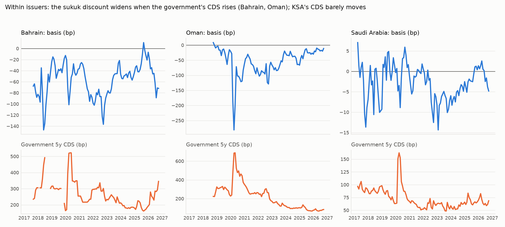
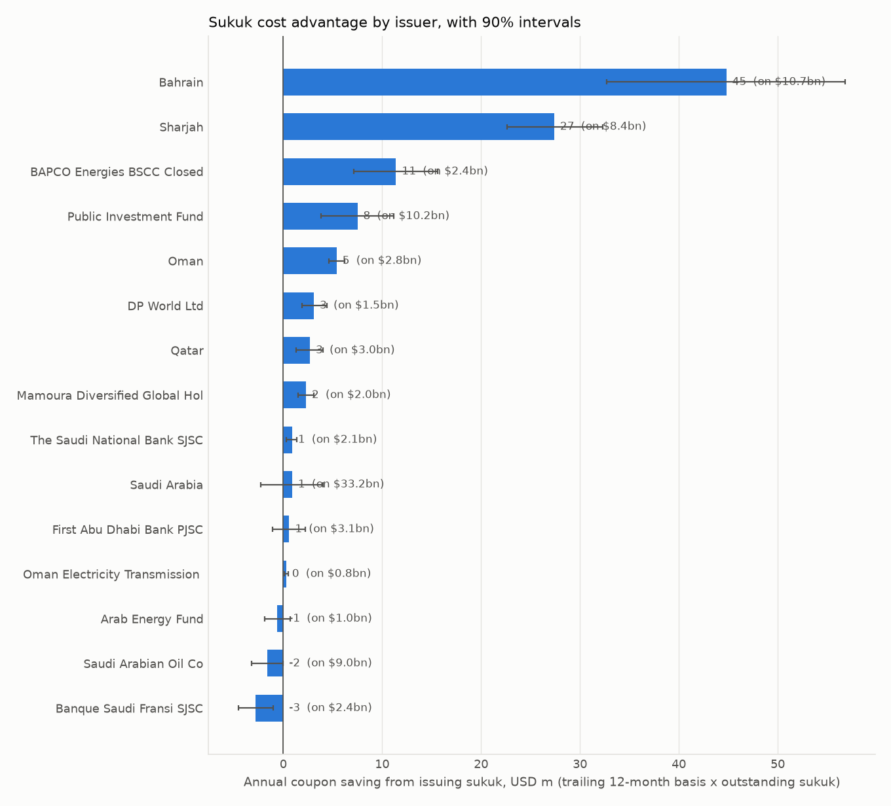

# GCC sukuk vs conventional bonds: synthesis

Generated 2026-10-29. Every number below is read from a stage report's CSV output.

## Headline numbers

1. **Sukuk trade below their own issuer's conventional curve.** -18.6bp average across 18 issuers (median -8.7bp); 16 of 18 negative; 8 of 8 obligor groups negative on average (issuers grouped by the government backing them; Sharjah and the multilateral Arab Energy Fund stand alone).
   *Holding the issuer fixed, investors accept a lower yield on sukuk.*
2. **The discount is a sub-investment-grade phenomenon.** Sub-IG issuers -50bp vs investment grade -5bp: gap -45bp, wild bootstrap p = 0.015 by obligor group. With a time-varying rule (government CDS above 150bp that month) the gap is -55bp (p = 0.077 by obligor group, 0.022 by issuer); with time-varying ratings (2 of 3 agencies below BBB-/Baa3, Dubai via its DEWA proxy) -58bp (p = 0.038; -56bp, p = 0.074, with Dubai excluded). Oman's discount narrowed by 21bp (90% CI [10.3, 32.4]) in the year after Moody's upgrade made it investment grade at two of three agencies.
   *A threshold, not a smooth gradient: investment-grade issuers get single-digit discounts.*
3. **Within the weakest sovereigns, the discount moves with credit risk.** Oman -21.5bp and Bahrain -19.2bp per 100bp of CDS (Newey-West t -4.0, -3.0); also in monthly changes (-50.0, -21.2). For investment-grade issuers the within slope is +3.4bp.
   *The pooled panel slope (-22.0bp) is not significant on its own once only six CDS series are counted (wild bootstrap p = 0.287); the case studies carry the claim.*
4. **The discount exists at issue, not only in secondary quotes.** Weak-credit sukuk priced a median -39.7bp against their issuer's conventional curve at issue, vs +19.8bp for the same issuers' new conventional bonds and -1.7bp for other issuers' sukuk; issuer-level correlation with the secondary basis 0.78.
   *Stale secondary quotes cannot explain a discount that is already there on the pricing date.*
5. **Sukuk quotes are somewhat stale, but that is not the story.** Unchanged mid price on 7.9% of days for sukuk vs 1.5% for conventionals; sukuk absorb 0.47 of a conventional move on the day and 0.62 within a week (weak credits 0.56, KSA 0.89); 46% of the pooled same-month CDS effect reverses within six months (Bahrain: no reversal).
   *Even after 120 business days sukuk move 0.83bp per conventional bp: damping is real, and stale quotes explain only part of the monthly CDS response.*
6. **Mechanism: tenor and buy-and-hold demand, with modest evidence.** Holm-adjusted p-values across the four mechanism tests (government-clustered wild bootstrap): CDS slope steepens by -2.1bp per 100bp per year of maturity (p 0.138); less liquid sukuk price richer, -0.81bp per bp of bid-ask gap (p 0.076); CDS x interbank spread -0.10 per bp (p 0.626); CDS x Ijara +10.9 (p 0.718), a low-power test because only 10 of the 68 twin sukuk are Ijara (43 are Hybrid).
   *After the multiple-testing correction none clears 5%; the tenor and liquidity signs fit default/recovery pricing plus buy-and-hold demand. The Ijara test cannot rule asset backing in or out.*
7. **Oil shocks do not move the basis directly.** Median basis response to an oil-price rise +0.6bp at +5 days; the test could detect 3.1bp (+5) or 4.9bp (+20) with 80% power. Implied via credit: +0.71bp (90% CI [-0.82, 2.77]).
   *Oil reaches the basis only through credit risk, and oil up-shocks in this sample raise GCC CDS (median +5.9bp at +5 days, placebo p < 0.001); several of them are regional conflicts.*
8. **What it is worth.** Bahrain about USD 45m a year; Sharjah about USD 27m a year; BAPCO Energies BSCC Closed about USD 11m a year (trailing-12-month basis x outstanding USD sukuk). Investment-grade sovereigns without USD sukuk (Kuwait, Abu Dhabi, UAE federal): predicted USD 0.3-1.3m per USD 1bn issued, intervals including zero.
   *Sukuk issuance pays most for the weakest credits, which is where the discount sits.*

## Main specifications

| specification | estimate | inference | source |
|---|---|---|---|
| Twin-curve basis, cross-issuer mean | -18.6bp | t = -2.78 across 18 issuers | twin_results.md |
| Sub-IG minus IG basis (level, snapshot ratings with Oman sub-IG) | -45.0bp | wild p = 0.015 (obligor groups, 8 clusters) | credit_results.md |
| Sub-IG minus IG basis (time-varying: CDS > 150bp) | -54.6bp | wild p = 0.077 (obligor groups), 0.022 (issuer) | mechanism_results.md |
| Sub-IG minus IG basis (time-varying ratings, 2 of 3 agencies below BBB-/Baa3, Dubai via DEWA proxy) | -58.2bp | wild p = 0.038 (obligor groups), 0.014 (issuer) | mechanism_results.md |
| Sub-IG minus IG basis (time-varying ratings, Dubai excluded (robustness)) | -56.4bp | wild p = 0.074 (obligor groups), 0.009 (issuer) | mechanism_results.md |
| Extra CDS slope when sub-IG (time-varying ratings, 2 of 3 agencies below BBB-/Baa3) | -35.0 per 100bp | wild p = 0.038 (obligor groups), 0.014 (issuer) | mechanism_results.md |
| Extra CDS slope when sub-IG (time-varying ratings, Dubai excluded (robustness)) | -33.4 per 100bp | wild p = 0.096 (obligor groups), 0.039 (issuer) | mechanism_results.md |
| Oman: basis change after Moody's upgrade (12m vs 12m) | +21.4bp | Newey-West 90% CI [10.3, 32.4] | mechanism_results.md |
| Oman: basis on CDS, levels / changes | -21.5 / -50.0 per 100bp | NW t -4.0 / -7.4 | credit_results.md |
| Bahrain: basis on CDS, levels / changes | -19.2 / -21.2 per 100bp | NW t -3.0 / -4.3 | credit_results.md |
| Panel within slope (issuer FE + liquidity) | -22.0 per 100bp | cluster t -5.4; wild p = 0.287 (obligor groups), 0.105 (issuer) | credit_results.md |
| Panel, first differences | -30.4 per 100bp | wild p = 0.183 (obligor groups) | mechanism_results.md |
| Extra within slope for sub-IG issuers | -27.9 per 100bp | wild p = 0.185 (obligor groups), 0.063 (issuer) | mechanism_results.md |
| CDS x remaining maturity | -2.09 per 100bp per year | wild p = 0.046; Holm-adjusted 0.138 | mechanism_results.md |
| Liquidity gap | -0.81bp per bp | wild p = 0.019; Holm-adjusted 0.076 | mechanism_results.md |
| CDS x Ijara (low power: few Ijara sukuk) | +10.9 per 100bp | wild p = 0.718; Holm-adjusted 0.718 | mechanism_results.md |
| CDS x interbank spread | -0.10 per 100bp per bp | wild p = 0.313; Holm-adjusted 0.626 | mechanism_results.md |
| New-issue premium, weak-credit sukuk minus conventional | -59.5bp (medians) | 21 sukuk, 29 conventional | data_quality_results.md |
| Oil-price rise, basis at +5 days (median) | +0.6bp | MDE80 3.1bp | event_study.md |
| Implied via CDS, +5 days | +0.71bp | 90% CI [-0.82, 2.77] | oil_credit_results.md |

## Charts

**1. The discount across issuers is a threshold** (sub-investment-grade issuers marked as squares; the Dubai government's basis rests on 20-year interpolation brackets and is excluded from the fits):

**2. Within issuers, the discount follows the government's CDS where CDS moves** (Bahrain, Oman), and stays near zero where it does not (KSA):

**3. What the discount is worth by issuer:**

## Where to read more

- twin_results.md: the twin-curve method, matching validation and the basis by issuer.
- credit/credit_results.md: CDS evidence, case studies, wild bootstrap.
- mechanism/mechanism_results.md: structure, tenor, captive demand, threshold, inference.
- data_quality/data_quality_results.md: staleness, lead-lag, reversal, primary market.
- event_study/event_study.md and oil_credit/oil_credit_results.md: oil shocks and the credit channel.
- policy/policy_results.md: savings and the counterfactual.
- drivers/drivers_results.md: interbank, issuance and the common factor.

## Main caveats

- Six independent sovereign CDS series and 18 issuers: small-sample inference throughout.
- The headline level gap uses export-date snapshot ratings with Oman counted as sub-IG; the time-varying rating rule (hand-compiled histories; Dubai proxied by DEWA, rationale in README.md) and the CDS rule confirm it. Under the 2-of-3 rule Sharjah counts as investment grade.
- Secondary sukuk quotes are staler than conventional ones; the primary-market check is the defence.
- Raw LSEG data is not distributed with this repository.
