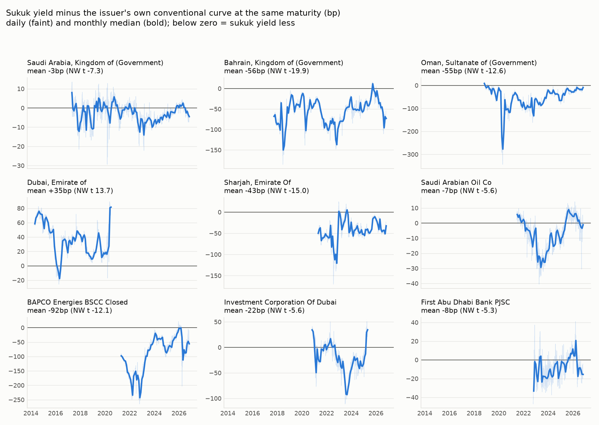
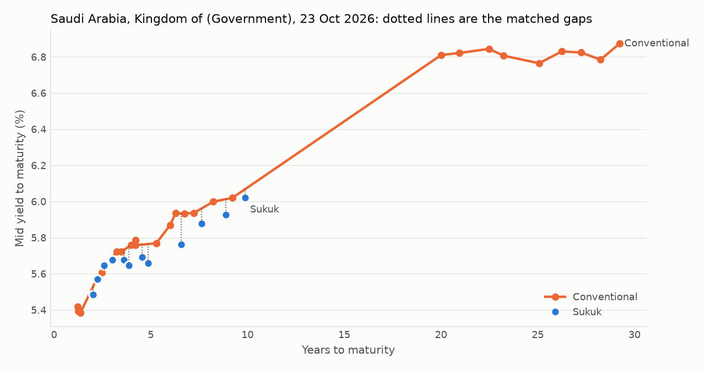

# Within-issuer twin-curve analysis: GCC sukuk vs conventional (USD)

Generated 2026-10-25 from `data/USD/timeseries`.

## Method

- **Sample:** plain fixed-coupon bonds of at least $100m, one line per bond, issuers with both sukuk and conventional bonds (same Sukuk Obligor / Borrower). Yield = LSEG mid YTM (bid/ask average where mid is missing).
- **Cleaning:** 1-30 years to maturity; yields in (0, 25)%; drop points more than 1.5pp from a 21-day rolling median; drop stale runs of 5+ identical prices and bonds stale on > 50% of days. Kept 330,031 of 359,606 bond-days (dropped: yield_bounds 1,041, tau_range 24,991, outliers 97, stale 3,446).
- **Tenor matching:** for each sukuk on each day, the issuer's conventional yields that day are linearly interpolated at the sukuk's remaining maturity, using only the two conventional bonds that bracket it (no extrapolation). If no two bonds bracket it, the nearest conventional bond within 1 year is used, shifted along that day's US Treasury curve to the sukuk's maturity: y_near + UST(sukuk maturity) - UST(nearest maturity). Share per issuer: `share_nearest_adj`. **Basis = sukuk yield minus matched conventional yield, in bp.** Negative means the sukuk yields less than the issuer's own conventional curve.
- **Excluded:** emirates (amortizing aircraft sukuk: yield to final maturity is not comparable).
- **Inference:** per issuer, the daily average basis is a time series; its mean has a Newey-West standard error (20 lags). Across issuers, each issuer's mean counts once, so KSA and Bahrain do not dominate. Issuers need at least 20 matched days.

## Headline

Across **18 issuers**, the mean of issuer-level mean bases is **-18.6bp** (cross-issuer t = -2.78; median -8.7bp). **16 of 18** issuers have a negative mean basis.

## By issuer

| issuer | country | sovereign | first_date | last_date | days | sukuk_bonds | mean_basis_bp | nw_se_bp | nw_t | median_basis_bp | p25_bp | p75_bp | share_negative_days | median_bracket_width_y | share_nearest_adj |
|---|---|---|---|---|---|---|---|---|---|---|---|---|---|---|---|
| Saudi Arabia, Kingdom of (Government) | Saudi Arabia | True | 2017-04-21 | 2026-10-23 | 2480 | 14 | -2.9 | 0.4 | -7.33 | -2.5 | -6.0 | 0.7 | 0.7 | 1.0 | 0.01 |
| Bahrain, Kingdom of (Government) | Bahrain | True | 2017-09-20 | 2026-10-23 | 2356 | 12 | -56.0 | 2.8 | -19.95 | -50.3 | -77.9 | -34.0 | 0.99 | 1.4 | 0.26 |
| Oman, Sultanate of (Government) | Oman | True | 2018-10-31 | 2026-10-23 | 2068 | 3 | -55.3 | 4.4 | -12.55 | -41.3 | -76.6 | -23.5 | 0.99 | 1.5 | 0.06 |
| Dubai, Emirate of | United Arab Emirates | True | 2014-04-30 | 2020-06-19 | 1496 | 1 | 35.4 | 2.6 | 13.66 | 36.2 | 18.0 | 48.6 | 0.05 | 21.6 | 0.0 |
| Sharjah, Emirate Of | United Arab Emirates | True | 2021-04-23 | 2026-10-23 | 1431 | 8 | -43.4 | 2.9 | -14.97 | -43.5 | -54.5 | -29.3 | 0.97 | 3.0 | 0.13 |
| Saudi Arabian Oil Co | Saudi Arabia | False | 2021-06-17 | 2026-10-23 | 1397 | 6 | -6.9 | 1.2 | -5.63 | -5.6 | -14.2 | 1.8 | 0.68 | 3.4 | 0.0 |
| BAPCO Energies BSCC Closed | Bahrain | False | 2021-04-08 | 2026-10-23 | 1377 | 1 | -92.1 | 7.6 | -12.12 | -76.7 | -145.1 | -42.0 | 0.98 |  | 1.0 |
| Investment Corporation Of Dubai | United Arab Emirates | False | 2020-10-28 | 2025-04-25 | 1051 | 1 | -21.6 | 3.9 | -5.57 | -21.7 | -37.9 | -1.2 | 0.76 |  | 1.0 |
| First Abu Dhabi Bank PJSC | United Arab Emirates | False | 2022-10-13 | 2026-10-23 | 1036 | 5 | -7.6 | 1.4 | -5.35 | -8.3 | -16.3 | 0.8 | 0.73 | 0.5 | 0.35 |
| The Saudi National Bank SJSC | Saudi Arabia | False | 2022-01-19 | 2026-01-16 | 999 | 1 | -5.0 | 1.3 | -3.68 | -3.0 | -12.9 | 3.5 | 0.62 | 2.3 | 0.57 |
| Banque Saudi Fransi SJSC | Saudi Arabia | False | 2023-05-31 | 2026-10-23 | 850 | 1 | 3.0 | 2.0 | 1.46 | 1.6 | -7.1 | 12.1 | 0.46 |  | 1.0 |
| Dubai Aerospace Enterprise (DAE) Ltd | United Arab Emirates | False | 2021-01-20 | 2024-03-19 | 797 | 1 | -9.0 | 4.1 | -2.21 | -10.8 | -25.3 | 8.1 | 0.62 | 3.0 | 0.01 |
| Public Investment Fund | Saudi Arabia | False | 2023-10-25 | 2026-10-23 | 783 | 6 | -8.5 | 1.2 | -6.86 | -9.5 | -14.0 | -2.4 | 0.81 | 2.3 | 0.16 |
| Mamoura Diversified Global Holding PJSC | United Arab Emirates | False | 2024-04-04 | 2026-10-23 | 665 | 2 | -18.7 | 1.4 | -13.0 | -21.7 | -25.0 | -11.2 | 0.97 | 0.4 | 0.0 |
| DP World Ltd | United Arab Emirates | False | 2025-01-15 | 2026-10-23 | 463 | 2 | -29.8 | 3.8 | -7.91 | -35.5 | -44.4 | -13.7 | 0.94 | 18.8 | 0.5 |
| Qatar, State of (Government) | Qatar | True | 2025-11-10 | 2026-10-23 | 250 | 1 | -8.9 | 2.7 | -3.29 | -6.5 | -17.8 | -0.4 | 0.76 | 6.9 | 0.0 |
| Oman Electricity Transmission Company S.A.O.C | Oman | False | 2025-10-29 | 2026-10-23 | 239 | 1 | -4.5 | 1.6 | -2.78 | -3.8 | -10.1 | 1.6 | 0.69 | 3.7 | 0.51 |
| Arab Energy Fund | Saudi Arabia | False | 2024-04-23 | 2026-10-23 | 222 | 2 | -2.7 | 4.2 | -0.64 | -3.7 | -17.5 | 5.3 | 0.63 | 1.4 | 0.38 |

## Sovereign vs quasi-sovereign / corporate

| group | issuers | mean_of_issuer_means_bp | se_bp | t | median_of_issuer_means_bp | issuers_negative |
|---|---|---|---|---|---|---|
| Quasi-sovereign / corporate | 12 | -17.0 | 7.3 | -2.32 | -8.1 | 11 |
| Sovereign | 6 | -21.8 | 14.8 | -1.48 | -26.1 | 5 |

## Robustness

| variant | issuers | mean_of_issuer_means_bp | se_bp | t | median_of_issuer_means_bp | issuers_negative |
|---|---|---|---|---|---|---|
| Main: interpolation + UST-adjusted nearest (<= 1y) | 18 | -18.6 | 6.7 | -2.78 | -8.7 | 16 |
| Interpolation only | 15 | -15.8 | 6.2 | -2.55 | -8.9 | 14 |
| Interpolation brackets <= 10y | 17 | -21.3 | 6.2 | -3.45 | -8.9 | 16 |
| 2020 onward only | 18 | -18.6 | 6.9 | -2.71 | -8.7 | 16 |

## Matching validation: nearest bond vs interpolation

On sukuk-days where interpolation is possible, the nearest conventional bond alone is used and compared with the interpolated yield. *raw* = nearest yield as is; *adj* = shifted by the US Treasury slope. *Persistent* = each bond's error averaged over time (bonds with 50+ days), which is what can bias an issuer's mean basis. *Change* errors are what the event study and pass-through use.

| gap | sukuk_days | raw_bias_bp | raw_mae_bp | adj_bias_bp | adj_mae_bp | adj_p90_bp | bonds_50d | adj_persistent_median_bp | adj_persistent_p90_bp | adj_err_5d_change_median_bp | adj_err_20d_change_median_bp |
|---|---|---|---|---|---|---|---|---|---|---|---|
| <3m | 11796 | 0.2 | 2.0 | 0.0 | 1.7 | 4.0 | 20 | 0.8 | 2.2 | 0.5 | 0.7 |
| 3-6m | 13453 | 1.3 | 4.4 | 1.3 | 3.5 | 8.0 | 25 | 1.4 | 5.2 | 0.8 | 1.4 |
| 6-12m | 10744 | 3.9 | 9.0 | 1.9 | 7.8 | 19.0 | 16 | 3.4 | 15.7 | 1.1 | 1.8 |
| 1-2y | 2255 | -8.3 | 12.4 | -4.2 | 8.2 | 26.9 | 7 | 12.4 | 25.2 | 1.1 | 1.9 |
| 2-5y | 735 | -10.6 | 10.6 | -3.7 | 3.9 | 7.9 | 1 | 3.7 | 3.7 | 0.6 | 1.3 |

## Standard-tenor gaps (both curves interpolated at the tenor)

Needs at least two sukuk and two conventional bonds bracketing the tenor on the day.

| tenor | issuers | mean_of_issuer_means_bp | median_of_issuer_means_bp |
|---|---|---|---|
| 3 | 6 | -12.1 | -8.5 |
| 5 | 8 | -22.2 | -18.2 |
| 7 | 6 | -36.6 | -26.7 |
| 10 | 3 | -20.1 | -11.6 |

## Median daily basis by year (bp)

| parent_name | 2014 | 2015 | 2016 | 2017 | 2018 | 2019 | 2020 | 2021 | 2022 | 2023 | 2024 | 2025 | 2026 |
|---|---|---|---|---|---|---|---|---|---|---|---|---|---|
| Saudi Arabia, Kingdom of (Government) |  |  |  | -2.0 | -4.0 | 1.0 | 1.0 | -1.0 | -4.0 | -8.0 | -5.0 | -2.0 | -0.0 |
| Bahrain, Kingdom of (Government) |  |  |  | -69.0 | -85.0 | -35.0 | -44.0 | -56.0 | -92.0 | -52.0 | -52.0 | -31.0 | -46.0 |
| Oman, Sultanate of (Government) |  |  |  |  | -5.0 | -22.0 | -104.0 | -60.0 | -94.0 | -69.0 | -36.0 | -29.0 | -18.0 |
| Dubai, Emirate of | 71.0 | 50.0 | 15.0 | 39.0 | 20.0 | 20.0 | 28.0 |  |  |  |  |  |  |
| Sharjah, Emirate Of |  |  |  |  |  |  |  | -57.0 | -65.0 | -22.0 | -45.0 | -41.0 | -41.0 |
| Saudi Arabian Oil Co |  |  |  |  |  |  |  | 3.0 | -6.0 | -24.0 | -11.0 | 3.0 | 2.0 |
| BAPCO Energies BSCC Closed |  |  |  |  |  |  |  | -125.0 | -180.0 | -79.0 | -41.0 | -43.0 | -61.0 |
| Investment Corporation Of Dubai |  |  |  |  |  |  | 24.0 | -6.0 | -1.0 | -51.0 | -31.0 | 11.0 |  |
| First Abu Dhabi Bank PJSC |  |  |  |  |  |  |  |  | -8.0 | -17.0 | -12.0 | 1.0 | -8.0 |
| The Saudi National Bank SJSC |  |  |  |  |  |  |  |  | -16.0 | -3.0 | 2.0 | 1.0 | 1.0 |
| Banque Saudi Fransi SJSC |  |  |  |  |  |  |  |  |  | -10.0 | -3.0 | 9.0 | 8.0 |
| Dubai Aerospace Enterprise (DAE) Ltd |  |  |  |  |  |  |  | 14.0 | -11.0 | -31.0 | -23.0 |  |  |
| Public Investment Fund |  |  |  |  |  |  |  |  |  | -12.0 | -13.0 | -2.0 | -11.0 |
| Mamoura Diversified Global Holding PJSC |  |  |  |  |  |  |  |  |  |  | -23.0 | -23.0 | -10.0 |
| DP World Ltd |  |  |  |  |  |  |  |  |  |  |  | -43.0 | -12.0 |
| Qatar, State of (Government) |  |  |  |  |  |  |  |  |  |  |  | 1.0 | -11.0 |
| Oman Electricity Transmission Company S.A.O.C |  |  |  |  |  |  |  |  |  |  |  | -10.0 | -3.0 |
| Arab Energy Fund |  |  |  |  |  |  |  |  |  |  | -8.0 |  | 2.0 |

## Curve snapshot check

## Caveats

- Yields are LSEG mid YTMs, so the basis also picks up coupon and convexity differences between bonds. These are small at matched maturity but not zero.
- Linear interpolation across wide brackets is crude: see `median_bracket_width_y` and the narrow-bracket robustness row. Dubai and DP World rely on brackets of about 20 years.
- Secondary-market coverage is essentially 2019 onward. Earlier years have few issuers.
- Some issuers are thin, with one sukuk or under 200 days. Read their t-stats with care.
- Matching is by obligor/borrower name. Sukuk issued through a parent's SPV under a different obligor name will be missed.
- 12 conventional-file lines that look like sukuk are excluded (see summary.md).

Files: `twin_basis_obs.parquet` (sukuk-day level), `twin_basis_issuer_daily.csv`, `twin_issuer_stats.csv`, `twin_tenor_gaps.csv`, `twin_robustness.csv`.
